# BiteBox: System Blueprint

A one-document picture of the whole BiteBox platform: what it does, who uses it, how the parts fit together, how data and orders flow, how it is secured and deployed, and where it should go next.

- **Who it is for:** anyone who needs the big picture — new developers, reviewers, project leads, partners evaluating the platform.
- **Going deeper:** [FRONTEND.md](FRONTEND.md) and [BACKEND.md](BACKEND.md) (developer guides), [DOCUMENTATION.md](DOCUMENTATION.md) (endpoints, screens and business rules), Swagger at `/api/docs` (live API contract).

## 1. Summary

BiteBox is a food delivery platform with **four role-based panels** in one web app:

| Panel | Users | What they do |
|---|---|---|
| **Customer site** | Customers (and visitors) | Find restaurants near a delivery point, search dishes and places, order with cash or online payment, track the rider live, rate, earn and spend coins, refer friends, get support |
| **Restaurant panel** | Restaurant partners | Onboard with KYC, manage the menu and offers, accept and prepare orders, see nearby riders, follow earnings and payouts, reply to reviews |
| **Delivery panel** | Riders | Go online, accept delivery requests, navigate to pickup and drop, share live GPS, confirm delivery with a code, follow earnings |
| **Admin panel** | Super admin and staff roles | Approve partners, run operations and dispatch, manage orders, coupons, rewards and promotions, handle refunds, payouts and support, moderate reviews, audit everything |

**At a glance**

| Measure | Value |
|---|---|
| Frontend | Angular 22 · 196 components · ~106 routes · ~61,700 lines · 324 unit tests (all passing) |
| Backend | Django 5.2 + DRF · 22 apps · 59 data models · 246 API routes · ~33,900 lines · 721 tests (all passing) |
| Data | PostgreSQL 16 + PostGIS, Redis 7 |
| Realtime | One WebSocket (`/ws/`) for order updates, rider location and notifications |
| Background work | Celery worker + beat (8 scheduled jobs) |
| Delivery | Docker Compose: nginx → Angular SSR + Django API + worker + beat + PostGIS + Redis |

## 2. System context

Who and what BiteBox talks to.

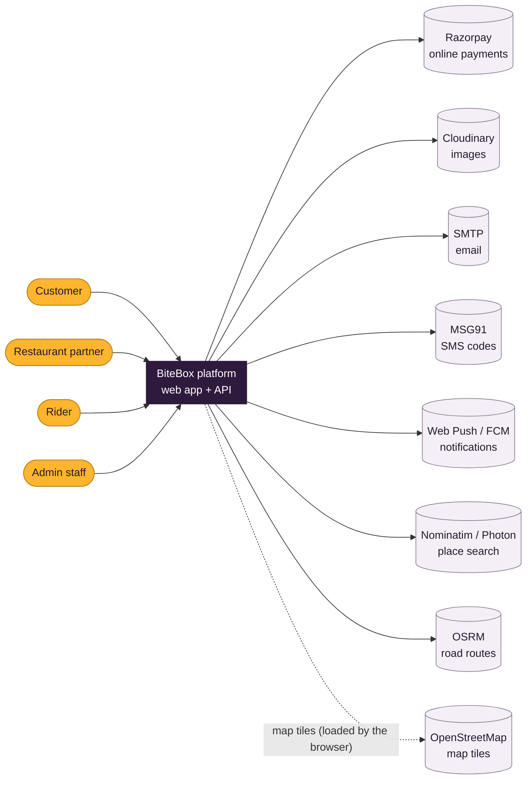

- Every external service is optional in development: payments fall back to a **mock gateway**, images to **local disk**, SMS codes to the **console**, push stays off without keys.
- Place search and routing go **through the API** (cached and rate-limited), never directly from the browser.

## 3. Architecture

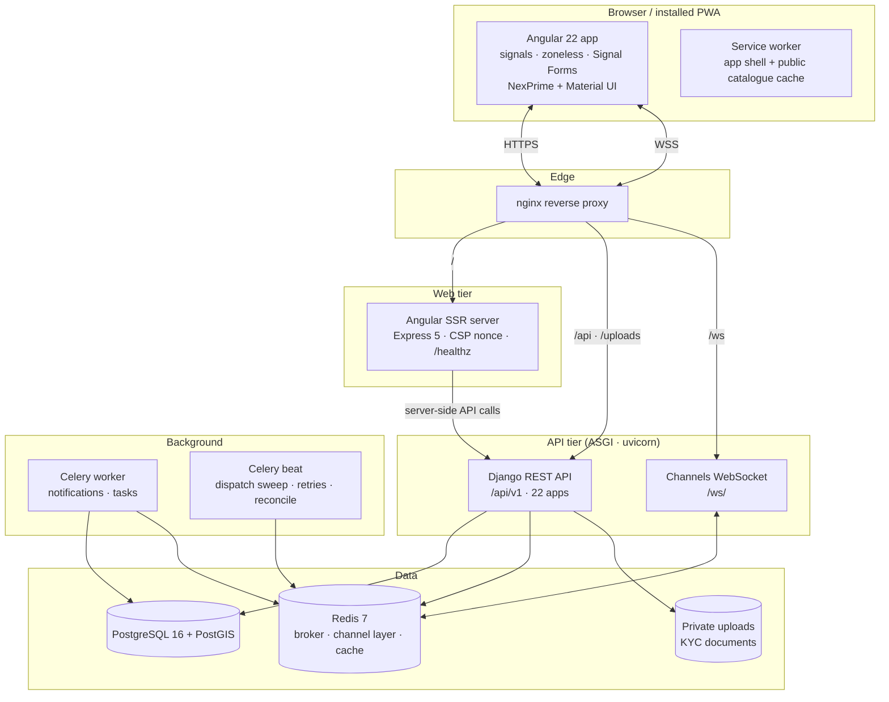

**Design principles**

- **One source of truth on the server.** Prices, discounts, fees and totals are computed by the API in integer paise; the client never calculates money.
- **Thin views, rich services.** Each backend app has `services.py` for logic; views only check permission, validate and call a service.
- **Single owners for critical state.** Order status changes only in `orders/workflow.py`; coin wallets only in `coins/wallet.py`; finance rows only in `finance/ledger.py`.
- **Deny by default.** Every API view needs an explicit permission; public routes are listed and tested.
- **Events are hints, REST is truth.** Socket events carry ids and statuses; screens re-read over REST, with a slow fallback poll.
- **Idempotent side effects.** Retried requests, webhooks and background jobs can run twice without double-charging, double-crediting or double-posting.

### 3.1 Frontend layers

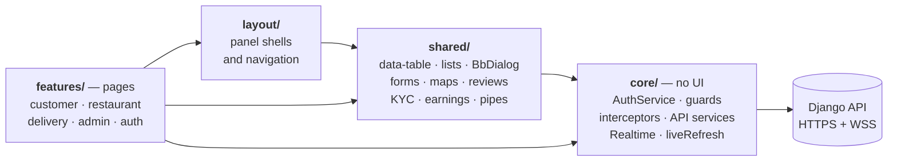

| Layer | Lines | Rule |
|---|---|---|
| `features/` (pages) | ~36,100 (admin 17,460 · customer 11,287 · restaurant 3,453 · delivery 2,872 · auth 1,043) | One folder per panel; every page lazy-loaded |
| `shared/` | ~17,900 | Reusable, role-agnostic; no direct routing assumptions |
| `core/` | ~7,600 | Services, guards, interceptors, models; no templates |
| `layout/` | ~2,000 | Panel shells and navigation |

### 3.2 Backend layers and app dependencies

Each request goes **URL → view (permission + validation) → service → model**. Apps call each other's services directly. The most depended-on apps form the base layer:

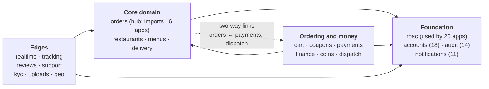

- **`orders` is the hub:** it imports 16 other apps (dispatch, finance, payments, coins, coupons, realtime, notifications…).
- **Two-way links exist** (for example `orders` ↔ `payments`, `orders` ↔ `dispatch`, `accounts` ↔ `orders`). They work through function-level imports but make changes ripple further than the folder structure suggests (see §12).

### 3.3 API surface

| Audience | Prefix | Routes |
|---|---|---|
| Admin panel | `admin/…` | 112 |
| Customers and public catalogue | `restaurants`, `foods`, `cart`, `orders`, `payments`, `coins`, `support`, `geo`… | 74 |
| Restaurant panel | `my/restaurant/…` | 23 |
| Sign-in and account | `auth/…` | 18 |
| Rider panel | `delivery/…` | 16 |
| Monitoring | `health…` | 3 |
| **Total** | `/api/v1/` | **246** |

Every route returns the same envelope (`{success, message, data}`), is described in the OpenAPI schema (validated in CI), and is covered by the role × route access test.

## 4. Functional blueprint

| Domain | Capabilities | Backend apps | Frontend areas |
|---|---|---|---|
| **Identity & access** | Sign-up (email code), password and phone-code sign-in, email/phone verification, sessions, staff roles and custom permissions, account status, audit log | `accounts`, `rbac`, `audit` | `auth`, admin accounts/staff |
| **Catalogue & discovery** | Restaurants, categories, dishes, nearby search (15 km), search by name/cuisine/dish/place, filters (rating, cost, veg, open now, offers), public pages | `restaurants`, `menus`, `geo` | customer home, list, detail, dish search |
| **Partner onboarding** | Restaurant and rider registration, KYC documents (encrypted), payout bank account, admin approval | `restaurants`, `delivery`, `kyc`, `uploads` | restaurant/rider verification, admin review |
| **Cart & pricing** | Server-side quote, delivery fee, taxes, discount stacking (restaurant offer → platform offer → coupon → payment offer), coins | `cart`, `coupons`, `coins` | restaurant cart dock, checkout |
| **Ordering** | Place order (idempotent), status workflow, cancellations, restaurant board, admin intervention | `orders` | customer orders, restaurant orders, admin orders |
| **Dispatch & delivery** | Nearest-rider matching, one offer at a time, timeouts, live GPS, delivery code, tracking map | `dispatch`, `delivery`, `tracking`, `realtime` | delivery panel, tracking maps |
| **Payments & finance** | COD, Razorpay, mock gateway, refunds, webhooks, settlements, double-entry ledger, commission, payouts, invoices, reports | `payments`, `finance` | checkout, admin finance, partner earnings |
| **Engagement** | Reviews and replies, moderation, coins, referrals, campaigns, birthday/welcome rewards, newsletter, promotions | `reviews`, `coins`, `newsletter`, `notifications` | ratings, rewards, admin rewards/promotions |
| **Communication & support** | In-app inbox, Web Push, FCM, email, SMS with retries; support tickets with internal notes | `notifications`, `support` | bell, notifications page, support desk |

### 4.1 End-to-end journey across the panels

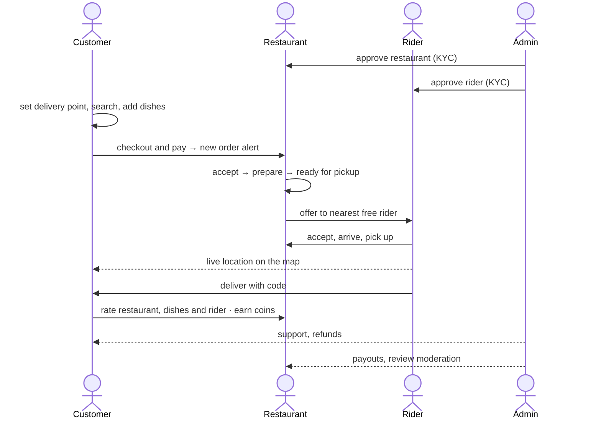

## 5. Data model

59 models in 22 apps. The core of the domain, in two parts.

### People, catalogue and cart

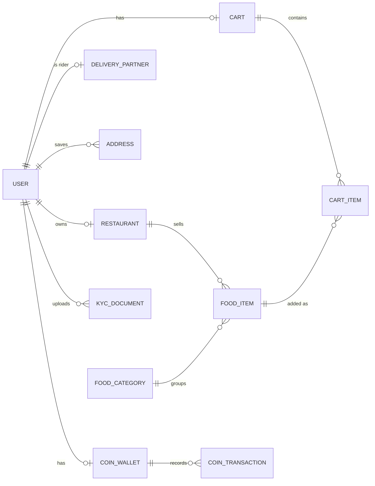

### Orders, money and delivery

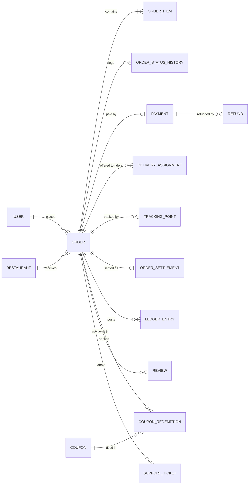

| Group | Models |
|---|---|
| Identity | `User`, `Session`, `OtpChallenge`, `AuditLog` |
| Catalogue | `Restaurant`, `FoodCategory`, `FoodItem` |
| Ordering | `Cart`, `CartItem`, `Address`, `Order`, `OrderItem`, `OrderStatusHistory`, `OrderCancellation` |
| Delivery | `DeliveryPartner`, `RiderVehicle`, `RiderAvailabilityLog`, `DeliveryAssignment`, `DispatchSettings`, `TrackingPoint` |
| Money | `Payment`, `Refund`, `WebhookEvent`, `PaymentCustomer`, `SavedCard`, `OrderSettlement`, `LedgerEntry`, `Payout`, `CommissionRule`, `Invoice`, `InvoiceSequence` |
| Promotions & loyalty | `Coupon`, `CouponRedemption`, `CoinWallet`, `CoinTransaction`, `CoinBatch`, `CoinAllocation`, `Referral`, `ReferralEvent`, `ReferralRewardCounter`, `RewardCampaign`, `RewardClaim`, `RewardConfiguration` |
| Engagement | `Review`, `ReviewResponse`, `ReviewEdit`, `ReviewModeration`, `ReviewReport`, `NewsletterSubscription` |
| Communication | `Notification`, `NotificationDelivery`, `PushSubscription`, `DeviceToken`, `ChannelPreference`, `SupportTicket`, `SupportMessage`, `SupportTicketEvent` |
| Compliance | `KycDocument`, `PayoutAccount` |

**Data rules**

- Primary keys are time-ordered UUIDs (UUIDv7); money is always integer paise.
- Orders store **snapshots** of items, prices, address and restaurant, so later menu edits never change history.
- Logs are append-only (`AuditLog`, `OrderStatusHistory`, `WebhookEvent`, `TrackingPoint`, `Notification`); coin and finance ledger rows are protected by database triggers.
- Locations are PostGIS `geography(Point)` columns, queried with distance and radius functions.

## 6. Key flows

### 6.1 Order lifecycle

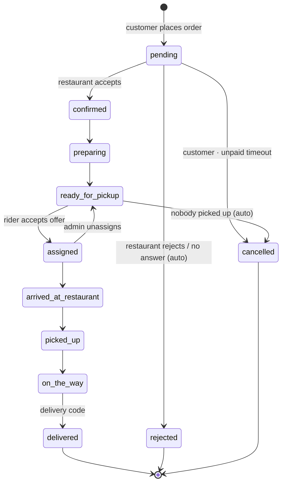

Every move goes through one function that checks who may make it, updates the row only if it is still in the expected status (a lost race returns 409), logs history, and then runs idempotent side effects: release the coupon, settle or refund the payment, free the rider, settle earnings on delivery, award coins, notify everyone, and emit a socket event.

### 6.2 Placing and paying for an order

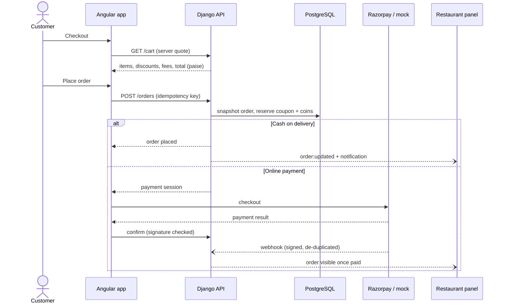

Unpaid online orders are cancelled automatically after the payment window (15 minutes), and reserved coupons and coins are released.

### 6.3 Dispatch and live tracking

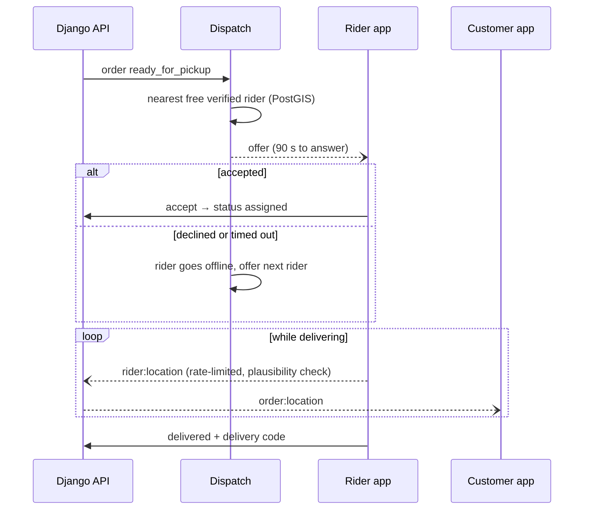

The **sweep** (every 15 s) expires offers, re-dispatches waiting orders and applies the timeouts (restaurant response, payment window, pickup window).

### 6.4 Notifications

`notify()` stores the inbox entry, pushes `notification:new` over the socket, and plans one delivery per external channel (Web Push, FCM, email, SMS) that the event uses and the person allows. Failed deliveries retry with back-off (1, 5, 15, 60 minutes) and then become dead letters that admins can retry.

### 6.5 Sign-in and session

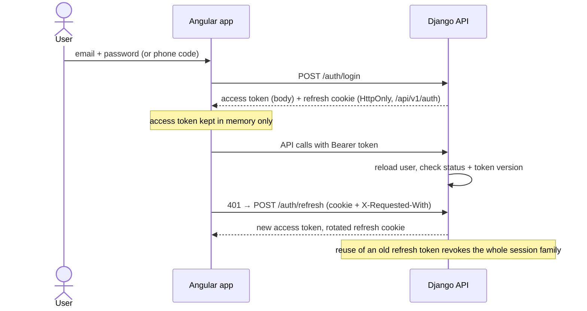

Page reload restores the session from the refresh cookie; password change, suspension or role change invalidate existing tokens immediately.

## 7. Access model

| Role | Panel | Default permissions |
|---|---|---|
| `customer` | Customer site | Own cart, orders, addresses, reviews, coins, tickets |
| `restaurant` | Restaurant panel | Own restaurant only (scope taken from the signed-in user) |
| `delivery` | Delivery panel | Own offers, active order, earnings |
| `admin` (super admin) | Admin | All 30 permissions, including `admins:manage` |
| `operations_admin` | Admin | Orders (view/manage), operations, restaurants and riders (view, edit, status, approve, KYC, manage) |
| `finance_admin` | Admin | `finance:view`, `refunds:manage`, `payouts:manage` |
| `support_admin` | Admin | `support:manage`, `orders:view`, `customers:view/edit`, `reviews:moderate` |
| `operator` | Admin | Nothing by default; permissions granted per person |

- Admin permissions can be customised per person; "manage/edit" permissions automatically include the matching "view".
- The frontend hides pages, menu items and buttons a person can't use; the API enforces the same rules independently.
- An automated test checks **every route × method × role**.

## 8. Quality attributes

| Attribute | How BiteBox addresses it |
|---|---|
| **Security** | In-memory access tokens + rotating HttpOnly refresh cookie with theft detection; user re-checked on every request; Argon2 hashing; rate limits; CSP with per-page nonce; encrypted KYC numbers and bank accounts; private document storage; EXIF/GPS stripped from images; SSRF guard on push endpoints; secrets redacted from logs; full audit log |
| **Correctness** | Single owners for status, wallets and ledgers; conditional updates against races; idempotency keys; DB constraints and triggers; 721 backend tests (all passing) incl. access matrix, security and fuzzing |
| **Performance** | Lazy routes; SSR for the home page; prerendered auth pages; public catalogue cached by CDN (60 s) and the service worker; Leaflet and heavy UI loaded on demand; PostGIS indexes |
| **Reliability** | Health checks (`/health/live`, `/health/ready`, `/healthz`); payment reconciliation every 5 min; notification retries; graceful degradation when maps or routing are down |
| **Usability** | One responsive app for phone, tablet and desktop; light and dark themes; PWA install, offline page, push notifications |
| **Maintainability** | Typed code (TypeScript, mypy), lint and format (Prettier, ruff), OpenAPI contract validated in CI, separate component files, shared building blocks |

## 9. Deployment

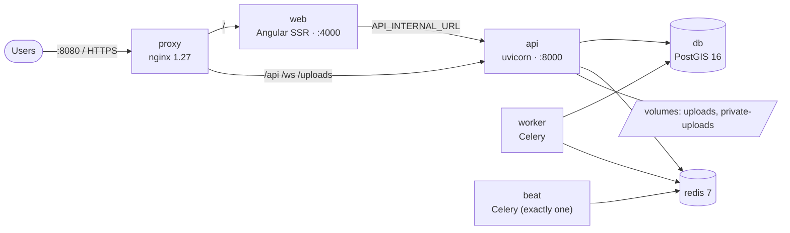

- `docker compose --env-file deploy/.env up -d --build` runs all seven services; migrations run separately (`docker compose run --rm api migrate`).
- The frontend can also be hosted statically (Vercel config included) with `/api` rewritten to the API.
- Production settings refuse to start without strong secrets, SMTP, an encryption key and allowed hosts, and force the mock gateway off.

## 10. Technology stack

| Layer | Technologies |
|---|---|
| Frontend | Angular 22, TypeScript 6, NexPrime, Angular Material/CDK, Leaflet, RxJS 7, Express 5 (SSR), service worker |
| Backend | Python 3.12, Django 5.2, DRF 3.18, Channels 4, Celery 5, drf-spectacular, PyJWT, Argon2, psycopg 3 |
| Data | PostgreSQL 16 + PostGIS 3.4, Redis 7 |
| Integrations | Razorpay, Cloudinary, SMTP, pywebpush (VAPID), FCM, MSG91, Nominatim/Photon, OSRM, OpenStreetMap |
| Quality | Vitest + jsdom, pytest, ruff, mypy, Prettier, pip-audit, GitHub Actions CI |
| Delivery | Docker (multi-stage images, non-root), Docker Compose, nginx |

## 11. Codebase health (measured 25 Nov 2026)

### Size

| Part | Files / units | Lines (excl. tests) | Tests |
|---|---|---|---|
| Frontend `src/app` | 196 components, 49 services, ~106 routes | ~61,700 (+ 1,965 global SCSS) | 96 spec files, ~7,100 lines |
| Backend `apps/`, `common/`, `config/` | 22 apps, 59 models, 246 routes, ~50 migrations | ~33,900 | 60 test files, ~17,000 lines |

Largest backend apps: `coins` (4,850 lines), `accounts` (3,130), `orders` (2,870), `reviews` (2,410), `finance` (2,180). Largest single files: `reviews/services.py` (918), `payments/services.py` (870), `coins/special.py`, `orders/services.py`, `coupons/services.py` (~825 each).

### Checks run

| Check | Result |
|---|---|
| Backend tests (`pytest`, PostgreSQL + PostGIS) | **721 passed**, 1 skipped (a Node comparison test, Node removed), 3 min 11 s |
| Frontend unit tests (Vitest) | **324 passed** in 96 files |
| `ruff format --check` / `ruff check` | Clean (322 files) |
| `mypy` | No issues (242 source files) |
| `manage.py check` / `makemigrations --check` | No issues, no missing migrations |
| Frontend production build | Builds; **2 budget warnings** (below) |
| TODO / FIXME markers | 2 in the whole codebase |
| Escape hatches | 8 `any` casts (frontend), 38 `type: ignore` (backend) |

### Bundle

| Measure | Size | Budget |
|---|---|---|
| Initial JavaScript + CSS (raw) | **973 kB** | warn 700 kB · error 1.2 MB → **over warning by 273 kB** |
| Initial transfer (compressed) | 230 kB | — |
| Largest lazy chunks | Lottie 171 kB, Leaflet 150 kB, Quill 140 kB | loaded only where used |
| `home.scss` | 14.3 kB | warn 12 kB → over by 2.3 kB |

**Cause found:** two root services import Angular Material at start-up — `core/services/install-prompt.service.ts` (`MatDialog`, created by the root `App`) and `core/services/notification.service.ts` (snackbar). That pulls Material's dialog code into the main bundle, against the project rule to keep Material and NexPrime out of eagerly loaded code.

## 12. Assessment

### Strengths

- Clear domain boundaries: one backend app per business area, one feature folder per panel.
- Money handled carefully: integer paise, server-side pricing, double-entry ledger, immutable coin ledger, idempotent payments and webhooks.
- Strong security baseline and an automated access matrix covering every route and role.
- Realtime done safely: authenticated socket, server-chosen rooms, REST as source of truth, polling fallback.
- Verified health: 721 backend and 324 frontend tests pass; ruff, mypy and Django checks are clean; almost no TODOs or type escapes.

### Risks and gaps

| # | Finding | Impact | Recommendation |
|---|---|---|---|
| 1 | CI (`.github/workflows/ci.yml`) still references `backend-django/` and runs npm in `backend/` | CI likely failing or not testing the real backend | Point the Django job at `backend/`, remove the Node job |
| 2 | Root `docker-compose.yml` runs the API with development settings, `--reload` and fallback secrets | Unsafe if used as-is in production | Add a production compose file (or override) with `config.settings.production` and required secrets |
| 3 | `CLAUDE.md` and parts of `DOCUMENTATION.md` still describe the Node backend | New contributors are misled | Update them to the Django architecture (see [BACKEND.md](BACKEND.md)) |
| 4 | Web Push keys (VAPID) and FCM are not configured | Phones don't receive notifications | Generate keys and set them in the environment; HTTPS in production |
| 5 | No end-to-end test suite | Cross-panel flows are checked manually | Add a small Playwright suite for order → dispatch → delivery |
| 6 | 17 screens still use `MatDialog`; Material and NexPrime both shipped | Bundle size and two dialog styles | Finish the move to `BbDialog` and NexPrime |
| 7 | `/admin/users/…` missing from the frontend page-permission map | Links visible to admins who can't open them | Add the entry in `core/auth/admin-pages.ts` |
| 8 | Initial bundle 973 kB, over the 700 kB budget; Material loaded at start-up by `InstallPromptService` and `NotificationService` | Slower first load on phones | Open the install dialog and snackbar through a dynamic `import()`; trim `home.scss` |
| 9 | Tight coupling between backend apps (`orders` imports 16 apps; two-way links such as `orders` ↔ `payments`) | Changes ripple; harder to test in isolation | Route cross-app reactions through small event modules (like `coins/events.py` already does) |
| 10 | Several service files exceed 800 lines (`reviews`, `payments`, `orders`, `coupons`, `coins/special`) | Harder to review and change | Split by sub-feature (e.g. refunds, webhooks, moderation) |
| 11 | Native mobile apps are not built (PWA only) | No app-store presence | If needed, wrap the PWA with Capacitor or a Trusted Web Activity |

### Suggested roadmap

1. **Stabilise (now):** fix CI, add a production compose setup, update `CLAUDE.md` and the reference docs, configure push keys, bring the start-up bundle back under budget.
2. **Harden (next):** end-to-end tests for the main flows, split the largest service files and loosen app coupling with event modules, monitoring and error tracking (e.g. Sentry), database backups.
3. **Grow (later):** finish the dialog/UI-library migration, native app wrappers, scheduled orders, multi-city operations, analytics dashboards.
